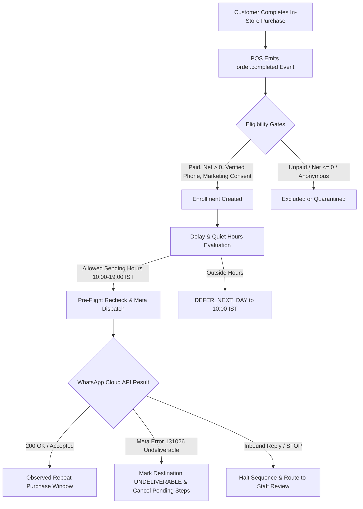

# F19b: Welcome Campaign v2 (`WELCOME_NEW_CUSTOMER`)

## 1. Feature Overview & Design Contract
The **GroVastra Auto Campaigns Welcome Campaign v2** (`WELCOME_NEW_CUSTOMER`) is an autonomous WhatsApp campaign engine purpose-built for handloom boutiques, silk houses, and apparel showrooms.

When a customer makes their first purchase, the boutique's POS records a completed bill. GroVastra anchors a single welcome message sequence (default: 1 step, 1-hour delay) that greets the patron on WhatsApp using approved Meta WhatsApp Cloud API templates (Graph API v25.0 pinned).

### Core Business Flow


### Architectural Component Mapping
| Step | Role | Implementing File Path |
| :--- | :--- | :--- |
| **1. Ingestion** | Order event inbox, schema validation, anonymization guard | [`apps/api/src/services/event-consumer.ts`](file:///d:/GROVIEWS/GroVastra/apps/api/src/services/event-consumer.ts) |
| **2. Facts Recompute** | Idempotent recalculation of `firstCompletedOrder` facts | [`apps/api/src/services/customer-facts/customer-facts.service.ts`](file:///d:/GROVIEWS/GroVastra/apps/api/src/services/customer-facts/customer-facts.service.ts) |
| **3. Enrollment** | Once-per-customer gate, branch scope, anchor binding | [`apps/api/src/presets/_shared/eventDelay/enrollerBase.ts`](file:///d:/GROVIEWS/GroVastra/apps/api/src/presets/_shared/eventDelay/enrollerBase.ts) |
| **4. Dispatch Timing** | 10:00–19:00 IST sending hours, blackout dates, deferrals | [`apps/api/src/presets/_shared/eventDelay/delayTiming.ts`](file:///d:/GROVIEWS/GroVastra/apps/api/src/presets/_shared/eventDelay/delayTiming.ts) |
| **5. Pre-flight Gate** | Stop on second order, contact health, offer validation | [`apps/api/src/presets/_shared/eventDelay/dispatchRecheck.ts`](file:///d:/GROVIEWS/GroVastra/apps/api/src/presets/_shared/eventDelay/dispatchRecheck.ts) |
| **6. Provider Dispatch** | Meta Cloud API v25.0 pinned, phone ID `1290524220819472` | [`apps/api/src/services/worker/worker.service.ts`](file:///d:/GROVIEWS/GroVastra/apps/api/src/services/worker/worker.service.ts) |
| **7. Webhook & Health** | Delivery tracking, Meta `131026` undeliverable cancellation | [`apps/api/src/services/webhook/webhook.service.ts`](file:///d:/GROVIEWS/GroVastra/apps/api/src/services/webhook/webhook.service.ts) |

---

## 2. Anchor Recomputation & Race Condition Resolution

### 1. Five Items on One Bill
A customer buying 5 sarees on a single invoice creates 5 line items inside 1 order (`lines: [...]`). The order completes as a single atomic event (`orderId: 'ord_101'`). The engine processes the order as exactly one qualifying anchor.

### 2. Five Bills on the Same Day
If a customer makes 5 separate purchases on their first day (e.g. initial saree, blouse piece, matching accessories):
- **Race Condition Prevention**: `customerFactsService.recomputeCustomerFacts(tenantId, customerId)` executes an aggregation over all completed, paid orders with `netPaise > 0`, sorting by `completedAt: 1, createdAt: 1, orderId: 1`.
- **Earliest Timestamp Anchor**: The order with the absolute earliest timestamp becomes `firstCompletedOrder`.
- **Terminal Enrollment Lock**: The compound unique index `{ tenantId: 1, customerId: 1, campaignId: 1, occurrenceId: 1 }` guarantees that subsequent orders on the same day cannot create additional enrollments (`ALREADY_WELCOMED`).
- **Second Order Auto-Halt**: If a subsequent order is completed before the delayed welcome message is dispatched, `dispatchRecheck` detects `orderCount > 1` (or `lastOrderAt > firstOrderAt`) and halts the pending message with `SECOND_PURCHASE_BEFORE_DISPATCH`.

---

## 3. Timing Algorithm & Worked Examples

Allowed sending hours are strictly **10:00 to 19:00 IST** (Asia/Kolkata).

$$\text{rawDueAt} = \text{anchorCompletedAt} + \text{delay}$$

### Example 1: Morning Purchase (Same-Day Delivery)
- **Purchase Completed**: 11:30 AM IST on Tuesday, 24 Oct.
- **Configured Delay**: 1 Hour (`HOURS`, value: 1).
- **Raw Due Instant**: 12:30 PM IST.
- **Hours Evaluation**: 12:30 PM is within 10:00–19:00 IST.
- **Result**: Dispatched at 12:30 PM IST on 24 Oct.

### Example 2: Evening Purchase (Next-Day Morning Deferral)
- **Purchase Completed**: 18:45 IST on Tuesday, 24 Oct.
- **Configured Delay**: 1 Hour (`HOURS`, value: 1).
- **Raw Due Instant**: 19:45 IST (outside allowed sending hours).
- **Policy**: `DEFER_NEXT_DAY`.
- **Target Send Window**: Next non-blackout day at 10:00 AM IST (Wednesday, 25 Oct 10:00 IST).
- **Deferral Duration**: 14 hours 15 minutes $\le$ `maxDeferralHours` (24h).
- **Result**: Status is `DEFERRED`, `adjustedDueAt` set to 25 Oct 10:00 IST, `deferralReason: 'OUTSIDE_SENDING_HOURS'`.

### Example 3: Exceeded Max Deferral Window
- If a store experiences a multi-day holiday/blackout extending beyond `maxDeferralHours` (e.g. 24h), the execution expires cleanly with `DEFERRAL_WINDOW_EXCEEDED` and is never sent unscheduled.

---

## 4. Destination Health & Phone Verification Pipeline

### Phone Normalization & Integrity
- Parsed and validated via `libphonenumber-js/max` with default country `IN` (+91).
- **Double-Entry Verification**: Staff counter entry requires entering phone number and confirm phone.
- **Suspicious Number Detection**: Checked via `isSuspiciousPhone()` for repetitive digits (`9999999999`) or sequential patterns (`1234567890`), flagging `WARNING_CODES.PHONE_SUSPICIOUS`.
- **Verification Levels**:
  - `CONFIRMED_BY_STAFF`: Staff confirmed with customer via counter readback.
  - `FORMAT_VALID`: Valid E.164 syntax via double-entry.
  - `UNVERIFIED`: Unconfirmed destination.

### Meta WhatsApp Error 131026 (`DESTINATION_UNDELIVERABLE`)
When Meta WhatsApp Cloud API returns error `131026` ("Message undeliverable to this destination / phone not on WhatsApp"):
1. `contactGateService.markUndeliverable(tenantId, destinationHash)` updates the destination gate:
   - `health.status = 'UNDELIVERABLE'`
   - `health.reason = 'Meta Cloud API 131026: Undeliverable'`
2. **Global Pending Cancel**: Cancels all pending, scheduled, and deferred executions matching `destinationHash` across all campaigns with reason `DESTINATION_UNDELIVERABLE`.
3. **Strict No Auto-Resend**: GroVastra NEVER auto-retries an undeliverable number.
4. **Correction Workflow**: If staff corrects the phone number via `POST /dev/mock-customers/:id/correct-phone`, a new `destinationHash` is issued, enabling new campaigns while preserving the old hash's tombstone.

---

## 5. API Reference

All requests must provide tenant credentials (Bearer JWT or `grovastra_auth_token` cookie) and enforce Hard Rule 1.

### 1. `GET /campaigns/:id/welcome/summary`
Returns comprehensive observability metrics for the Welcome Campaign.
- **Roles**: `owner`, `admin`, `staff`
- **Response Format (`200 OK`)**:
  ```json
  {
    "campaignId": "cmp_wel_order_mode",
    "scope": "PER_CUSTOMER",
    "firstPurchases": 120,
    "eligibleFirstPurchases": 110,
    "enrolled": 110,
    "delivered": 102,
    "failed": 2,
    "undeliverableCount": 2,
    "cancelled": 6,
    "noCustomerIdentityCount": 15,
    "existingCustomersNotWelcomed": 45,
    "retries": {
      "attempted": 2,
      "succeeded": 1,
      "policyNote": "Failures due to undeliverable destinations (Meta 131026) are never retried."
    },
    "needsStaffReviewCount": 1,
    "observationalRepeatPurchases": {
      "count": 18,
      "netPaise": 4500000,
      "attributionDisclaimer": "Spec p28: Observational only; no causal sales attribution claims."
    },
    "welcomeOffer": {
      "configured": true,
      "offerId": "off_wel_50",
      "redemptions": 12
    }
  }
  ```

### 2. `POST /dev/mock-customers`
Mock CRM endpoint for simulating boutique checkout customer creation.
- **Roles**: `owner`, `admin`, `staff` (Development/Testing only)
- **Request Body**:
  ```json
  {
    "firstName": "Lakshmi",
    "phone": "+91 98765 43210",
    "phoneConfirm": "+91 98765 43210",
    "branchId": "branch_main",
    "marketingOptIn": true,
    "consentSource": "COUNTER_FORM",
    "confirmedWithCustomer": true
  }
  ```
- **Response (`201 Created`)**:
  ```json
  {
    "customer": {
      "customerId": "cust_a1b2c3d4",
      "firstName": "Lakshmi",
      "destination": {
        "masked": "+91 98*** 43210",
        "destinationHash": "a6c5f7...",
        "verificationLevel": "CONFIRMED_BY_STAFF",
        "verificationMethod": "COUNTER_READBACK"
      }
    },
    "warnings": []
  }
  ```

### 3. `GET /destinations/health`
Inspects deliverability status across customer destinations.
- **Roles**: `owner`, `admin`
- **Query Params**: `?status=UNDELIVERABLE`
- **Response (`200 OK`)**: List of destinations with provider failure diagnostics.

---

## 6. Collections & Indexes

| Collection | Key Fields | Indexes |
| :--- | :--- | :--- |
| `campaignCustomerFacts` | `tenantId`, `customerId`, `firstCompletedOrder`, `orderCount` | `{ tenantId: 1, customerId: 1 }` (unique) |
| `campaignEnrollments` | `tenantId`, `campaignId`, `customerId`, `occurrenceId`, `scope`, `anchorAt` | `{ tenantId: 1, customerId: 1, campaignId: 1, occurrenceId: 1 }` (unique), `{ tenantId: 1, destinationHash: 1 }` |
| `campaignExecutions` | `tenantId`, `executionId`, `enrollmentId`, `state`, `rawDueAt`, `adjustedDueAt` | `{ tenantId: 1, executionId: 1 }` (unique), `{ tenantId: 1, state: 1, adjustedDueAt: 1 }` |
| `campaignContactGates` | `tenantId`, `destinationHash`, `health.status`, `lastContactedAt` | `{ tenantId: 1, destinationHash: 1 }` (unique), `{ tenantId: 1, 'health.status': 1 }` |
| `campaignProviderEvents` | `tenantId`, `provider`, `providerMessageId`, `eventType`, `payload` | `{ tenantId: 1, provider: 1, providerMessageId: 1, eventType: 1 }` (unique) |

---

## 7. Purchase-Based Policy
- **Purchase-Based Only**: Welcome is triggered strictly on qualifying first completed orders (`paid: true`, `status: 'COMPLETED'`, `netPaise > 0`). Legacy visit-based triggers have been removed completely.
- **Top-Level Summary**: Summary endpoint provides `firstPurchases` and `eligibleFirstPurchases`.
- **Seed State**: Order-mode seed customer IDs are prefixed with `cus_ord_*`.
