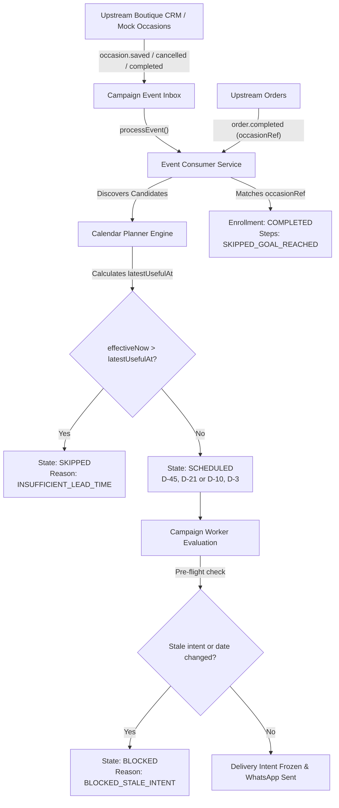

# F22: Preset Gift / Wedding Reminder (GIFT_WEDDING_REMINDER / Block G)

## 1. Feature Overview & Design Contract
The **Gift / Wedding Reminder Campaign** (`gift_wedding_reminder`, aliased to `gift_wedding`) automates timing-critical customer-declared occasion communications for apparel boutiques, bridal houses, and handloom retailers. Unlike annual calendar dates (birthdays, anniversaries), weddings and gift occasions operate on specific future dates (`YYYY-MM-DD`), require substantial fulfillment and tailoring lead times, and are prone to real-world rescheduling, postponements, or cancellations.

GroVastra connects with upstream boutique CRM sources, reads customer-declared occasion events (`src_customerEvents`), plans multi-step preparation sequences, enforces fulfillment lead-time cutoffs (`latestUsefulAt`), seamlessly revises schedules on date postponement without creating duplicate enrollments, cancels remaining steps upon occasion cancellation or completion, and halts follow-ups when an order tagged with `occasionRef` is completed.

### Core Principles & Hard Boundaries
- **Strict Tenant Isolation**: All occasion queries, enrollments, execution schedules, mock endpoints, and metrics are strictly scoped to the authenticated `tenantId` derived from context (Hard Rule 1). Cross-tenant data leakage is structurally impossible.
- **Occurrence Keying**: Occurrence keys follow the deterministic format:
  - Wedding: `wedding:{eventId}`
  - Gift: `gift:{eventId}`
- **Fulfillment Lead Time Enforcement (Spec p12, p31 B08)**:
  - `latestUsefulAt = eventDate - fulfillmentLeadDays` (evaluated at the end of allowed sending hours in the campaign timezone, UTC).
  - Default lead times:
    - `WEDDING`: 21 days (D-45 & D-21 default steps; priority 70).
    - `GIFT`: 2 days (D-10 & D-3 default steps; priority 65).
  - Any step past `latestUsefulAt` or evaluated when `effectiveNow > latestUsefulAt` is immediately `SKIPPED` with `INSUFFICIENT_LEAD_TIME` and the human-readable explanation:
    `"Skipped: needs <leadDays> days before the event; the event is in <daysUntilEvent> days"`.
- **Date Change & Rescheduling Semantics (Spec p12, p31 B20)**:
  - Postponements revise the existing occurrence in place—they never create duplicate enrollments.
  - Atomically increments `planRevision` (v1 -> v2).
  - Appends an audit entry to `dateHistory` (`{ at, oldDate, newDate, oldVersion, newVersion }`).
  - Unsubmitted executions (`deliveryIntentId: null`) are recalculated to the new event date.
  - In-flight worker claims with `deliveryIntentId !== null` are marked `BLOCKED` with `BLOCKED_STALE_INTENT`.
- **Lifecycle Cleanliness**:
  - `occasion.cancelled`: cancels pending executions with `OCCASION_CANCELLED` and sets enrollment status to `CANCELLED`.
  - `occasion.deleted`: cancels pending executions with `OCCASION_DELETED` and sets enrollment status to `CANCELLED`.
  - `occasion.completed`: cancels pending executions with `OCCASION_COMPLETED`, sets enrollment status to `COMPLETED`, and writes a durable `CampaignGoalEvent` with `source: 'OCCASION_COMPLETED'`.
- **Goal Attribution via `occasionRef`**:
  - An `order.completed` event carrying `occasionRef` equal to `wedding:{eventId}` or `gift:{eventId}` halts remaining `stopOnGoal: true` steps with `SKIPPED_GOAL_REACHED` and records an `ORDER_OCCASION` goal event.
  - Untagged orders (`occasionRef: null`) or mismatched tags do not affect the occasion sequence.
- **Store Booking Links & Anti-Pattern Warnings**:
  - Wedding campaigns can invite customers to book bridal styling via `shop.bookingLink`.
  - Campaign activation requires a valid `https://` URL in `settings.bookingLinkUrl`.
  - Copy linting emits a warning with code `BOOKING_CLAIM_WORDING_WARNING` if template text falsely claims an appointment is already booked/confirmed.
- **Zero Production Writes to Source Customer Events**: Production code treats `src_customerEvents` as an immutable external source (enforced by AST scan in test G32).
- **Privacy & Security**: Phone numbers are encrypted in storage (AES-256-GCM) and masked in logs/APIs. No partner or spouse contacts are ever inferred.

---

## 2. Technical Architecture & Component Flow

### Component Breakdown
1. **`apps/api/src/services/datetime/date-time-engine.ts`**:
   - `calculateLatestUsefulAt`: Computes cutoff instant as `eventDate - fulfillmentLeadDays` at the end of allowed sending hours.
   - `formatInsufficientLeadTimeReason`: Generates human-friendly skip reasons.
   - `getOccurrenceId`: Produces deterministic `wedding:{eventId}` and `gift:{eventId}` keys.
2. **`apps/api/src/services/planner/planner.service.ts`**:
   - Candidate discovery for `CUSTOMER_EVENT_DATE` with horizon filtering, `declaredByCustomer: true` gating, and status checking.
   - Evaluates audience rules against `occasion.budgetPaise` and `occasion.categories`.
   - Schedules steps into allowed sending hours, checking lead-time validity.
3. **`apps/api/src/services/event-consumer/event-consumer.service.ts`**:
   - Handles `occasion.saved`: enrolls new occasions or recalculates rescheduled ones (`planRevision` bump, `dateHistory` update, stale intent blocking).
   - Handles `occasion.cancelled`, `occasion.deleted`, `occasion.completed`.
   - Matches order completions by `occasionRef` to stop remaining campaign steps.
4. **`apps/api/src/services/worker/worker.service.ts`**:
   - Resolves late-bound parameters: `event.localDate`, `event.recipientLabel`, `shop.bookingLink`, `customer.firstName`.
   - Verifies against in-flight stale dates.
5. **`apps/api/src/routes/occasions.ts`**:
   - `GET /occasions`: Tenant-scoped, paginated customer occasions list.
   - `GET /campaigns/:id/occasion-reminders/summary`: Real-time observational metrics (in-window, active, lead-time skips, completed, replanned).
6. **`apps/web/`**:
   - Next.js UI integration: Occasion Kind selector, lead time inputs, booking link configuration, activity badges, timeline reschedule audit trails, registered customer occasions drawer, and dev-tools mock occasions CRM control panel.

---

## 3. Rules Implementation Matrix (G01–G36)

| Test ID | Requirement | Implementation & Verification |
| :--- | :--- | :--- |
| **G01** | Preset registry entry & aliasing | Registered in `CAMPAIGN_PRESETS` with ID `gift_wedding_reminder` and alias `gift_wedding`, defaults for trigger and steps, priority 70. Verified by `gift-wedding-reminder.test.ts`. |
| **G02** | Trigger validation: `occasionKind` | Validates `CUSTOMER_EVENT_DATE` requires `GIFT` or `WEDDING`. Rejects missing/invalid values. Verified in validation test. |
| **G03** | Lead days validation (0-180) | `fulfillmentLeadDays` requires integer between 0 and 180. Verified by boundary tests. |
| **G04** | Store `bookingLinkUrl` required | Campaign activation requires non-empty HTTP/HTTPS `bookingLinkUrl` in tenant settings when step uses `shop.bookingLink`. Verified by activation tests. |
| **G05** | Booking claim copy warning | Emits warning `BOOKING_CLAIM_WORDING_WARNING` if template or literal copy falsely claims an appointment is already booked. Verified by linter test. |
| **G06** | Discovery for WEDDING | Queries occasions with `kind: 'WEDDING'` within campaign horizon. Verified against mock customer source. |
| **G07** | Discovery for GIFT | Queries occasions with `kind: 'GIFT'` within campaign horizon. Verified against gift customer fixture. |
| **G08** | Customer declared gate | Occasions with `declaredByCustomer: false` are excluded from candidate discovery. Verified by undeclared fixture test. |
| **G09** | Active status gate | Occasions with status `CANCELLED`, `COMPLETED`, or `PAST` are excluded from candidate discovery. Verified by status tests. |
| **G10** | Audience rule evaluation | Evaluates audience rules against `occasion.budgetPaise` and `occasion.categories`. Verified with bridal wear & budget rules. |
| **G11** | Idempotent enrollment | Generates keys `wedding:{eventId}` and `gift:{eventId}`. Repeated planner runs maintain exactly 1 enrollment. Verified. |
| **G12** | WEDDING default steps | Schedules D-45 and D-21 at allowed sending hours in campaign timezone. Step 2 requires `PREVIOUS_ACCEPTED`. Verified. |
| **G13** | GIFT default steps | Schedules D-10 and D-3 relative to event date. Verified. |
| **G14** | `latestUsefulAt` computation | Deadline calculated as `eventDate - fulfillmentLeadDays` at end of allowed sending hours (UTC). Verified. |
| **G15** | Insufficient lead time skip | Executions evaluated with insufficient lead time marked `SKIPPED` with `INSUFFICIENT_LEAD_TIME` and owner-facing reason. Verified. |
| **G16** | Date postponement identity | `occasion.saved` with updated date revises existing enrollment in place; does not duplicate. Verified. |
| **G17** | Atomic plan revision bump | Postponement atomically increments `planRevision` (v1 -> v2). Verified. |
| **G18** | Recompute unsubmitted steps | Executions with `deliveryIntentId: null` have due dates and lead times recalculated. Verified. |
| **G19** | `dateHistory` audit trail | Date changes append `{ at, oldDate, newDate, oldVersion, newVersion }` to enrollment. Verified. |
| **G20** | In-flight stale intent guard | Date change while delivery intent is in-flight marks intent and execution `BLOCKED` with `BLOCKED_STALE_INTENT`. Verified. |
| **G21** | `occasion.cancelled` | Ingestion cancels unsubmitted executions with `OCCASION_CANCELLED` and marks enrollment `CANCELLED`. Verified. |
| **G22** | `occasion.deleted` | Ingestion cancels unsubmitted executions with `OCCASION_DELETED` and marks enrollment `CANCELLED`. Verified. |
| **G23** | `occasion.completed` | Ingestion cancels unsubmitted executions with `OCCASION_COMPLETED` and marks enrollment `COMPLETED`. Verified. |
| **G24** | Goal event on completion | Completed occasion records durable `CampaignGoalEvent` with `source: 'OCCASION_COMPLETED'`. Verified. |
| **G25** | State transition resilience | Subsequent domain events after terminal state do not corrupt database or resurrect completed campaigns. Verified. |
| **G26** | Goal attribution (WEDDING) | Order completed with matching `occasionRef: wedding:{eventId}` marks goal reached and cancels `stopOnGoal` steps with `SKIPPED_GOAL_REACHED`. Verified. |
| **G27** | Goal attribution (GIFT) | Order completed with matching `occasionRef: gift:{eventId}` marks goal reached and stops remaining steps. Verified. |
| **G28** | Untagged order ignored | Order completed without `occasionRef` does not affect occasion campaign steps. Verified. |
| **G29** | Mismatched tag isolation | Order completed with mismatched `occasionRef` does not affect unrelated occasions. Verified. |
| **G30** | Goal event with order ref | Tagged order creates durable `CampaignGoalEvent` with `source: 'ORDER_OCCASION'` and `orderRef`. Verified. |
| **G31** | Parameter resolution | Resolves `event.localDate`, `event.recipientLabel`, `shop.bookingLink`, `customer.firstName` accurately. Verified. |
| **G32** | Read-only guard on events | AST scan of all production code in `apps/api/src` confirms zero write calls to `SrcCustomerEventModel`. Verified. |
| **G33** | Phone encryption & masking | Phone stored encrypted with AES-256-GCM; masked in APIs; no partner contacts inferred. Verified. |
| **G34** | Occasion summary endpoint | `GET /campaigns/:id/occasion-reminders/summary` computes accurate observational metrics. Verified. |
| **G35** | Occasions API | `GET /occasions` returns tenant-isolated customer occasions with all fields. Verified. |
| **G36** | Seed scenario repeatability | `seedDatabase('gift-wedding')` executes cleanly, schedules live campaigns, skips short-lead occasions, and runs idempotently. Verified. |

---

## 4. Verification & Operational Evidence
- **Total Repository Test Run**: All 34 test suites and 467 tests pass with 0 failures (`pnpm test` / `vitest run`).
- **Seed Command**: `pnpm seed:gift-wedding` (or `npx tsx src/db/seed.ts --scenario gift-wedding`).
- **Web App Build**: `npm run build` in `apps/web` compiles all pages cleanly with 0 type or lint errors.
