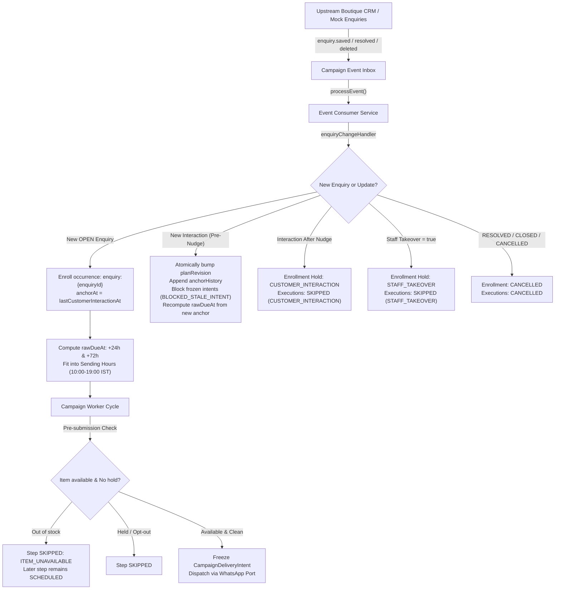

# F23: Preset Unresolved Enquiry (`unresolved_enquiry` / Block G)

## 1. Feature Overview & Design Contract
The **Unresolved Enquiry Preset** (`unresolved_enquiry`) automates timely, respectful WhatsApp follow-ups for in-store boutique customer product enquiries that did not convert immediately at the counter. When an apparel boutique customer enquires about an item (e.g. Kanjivaram silk saree, designer kurta, or linen shirt) or a styling query, staff record the enquiry in the boutique CRM.

GroVastra connects to upstream boutique enquiry and inventory sources (`src_enquiries`, `src_products`), plans a 2-step nudge sequence measured from the customer's last interaction, fits delivery into boutique sending hours (10:00–19:00 IST), re-evaluates item stock and customer interaction before dispatch, enforces marketing caps and consent, automatically pauses on customer reply or staff takeover, and completes when a qualifying purchase occurs.

### Core Principles & Hard Boundaries
1. **Sales Follow-up with Marketing Consent**:
   - Purpose is strictly `MARKETING` (priority 55).
   - Marketing consent (`marketingOptIn: true`) is required. If consent is absent, destination unverified/undeliverable, or channel suppressed, enrollments skip with respective reason codes (`MARKETING_OPT_OUT`, `UNVERIFIED_DESTINATION`, `CHANNEL_SUPPRESSED`).
   - Daily (1 contact/24h) and weekly (3 contacts/7d) marketing caps apply across all boutique campaigns.
2. **Single Anchor Origin**:
   - Both nudges (+24h and +72h) are measured from the **SAME** anchor instant (`lastCustomerInteractionAt`), fitted into sending hours (10:00–19:00 IST in `Asia/Kolkata`).
   - Step 2 is **NOT** measured from Step 1.
   - Bounded by `usefulForDays` (default 14 days from enquiry creation, configurable 1–90 days). If a planned execution extends beyond `expiresAt`, it is skipped with `ENQUIRY_TOO_OLD`.
3. **External Source Read-Only Boundary**:
   - External data sources `src_enquiries` (`EnquirySource`) and `src_products` (`ProductSource`) are strictly external systems.
   - Production code under `apps/api/src/` (excluding `dev/` and `scripts/`) **NEVER** writes or mutates `src_enquiries` or `src_products` (verified by AST scan in test Q26).
4. **Anchor Movement & Replan Semantics**:
   - Upstream record edits (staff notes, topic tag, status unchanged, same `lastCustomerInteractionAt`) update the stored version snapshot without re-evaluating or replanning timing.
   - Newer customer interaction before any nudge: same occurrence (`enquiry:{enquiryId}`), unsent executions recomputed from the new anchor, atomically increments `planRevision` (v1 -> v2), appends to `anchorHistory`, and marks any in-flight frozen delivery intent `BLOCKED` with `BLOCKED_STALE_INTENT`.
5. **Holds & Staff Takeover**:
   - Customer interaction after an accepted nudge sets `CUSTOMER_INTERACTION` hold on the enrollment; remaining steps are skipped while held.
   - Upstream staff takeover sets `STAFF_TAKEOVER` hold.
   - Staff takeover cannot be lifted by an incoming event with `staffTakeover: false` (lifted ONLY via explicit `POST /campaigns/:id/enrollments/:id/resolve-hold`).
6. **Item Availability & Reservation Warning**:
   - Out-of-stock item at dispatch (`sellableQty: 0` or product `DISCONTINUED`) skips **THAT** step only with `ITEM_UNAVAILABLE`. Subsequent steps remain scheduled and proceed if stock is replenished.
   - Pre-submission CAS verifies stock in real time immediately before provider handoff.
   - Follow-up templates and copy must **NEVER** imply an item is reserved or held for the customer. Template linter emits `RESERVATION_WORDING` warning if reservation language is detected.
7. **Strict WhatsApp Cloud API Channel**:
   - WhatsApp Cloud API is the ONLY communication channel (Meta test number `1290524220819472`, Graph API `v25.0` pinned). Zero SMS or email fallbacks.
   - Single canonical parameter resolver `resolveTemplateParameters` builds all template payloads.

---

## 2. Technical Architecture & Component Flow



### Component Breakdown
1. **`apps/api/src/presets/unresolvedEnquiry/enquiryChangeHandler.ts`**:
   - `handleEnquiryChangeEvent`: Handles `enquiry.saved`, `enquiry.resolved`, `enquiry.deleted` events.
   - Detects record edits vs new interactions.
   - Atomically updates `planRevision` and `anchorHistory` on newer customer activity.
   - Sets `CUSTOMER_INTERACTION` and `STAFF_TAKEOVER` holds.
   - Enforces non-resurrection: cancelled or completed enrollments are never revived by subsequent events.
2. **`apps/api/src/presets/_shared/eventDelay/delayTiming.ts`**:
   - `computeDueTimes`: Pure calculation function for `EVENT_DELAY` / `ENQUIRY_EVENT_DELAY`.
   - Computes `rawDueAt = anchorAt + delay`.
   - Evaluates tenant allowed sending hours (10:00–19:00 IST), blackout dates, and holidays.
   - Deferral logic: defers outside-hours executions to 10:00 IST today or next morning, verifying `maxDeferralHours`.
   - Bounds `expiresAt = min(adjustedDueAt + maxLateness, campaignEndAt, createdAt + usefulForDays)`.
3. **`apps/api/src/presets/_shared/eventDelay/dispatchRecheck.ts`**:
   - `performPreSubmissionRecheck`: Evaluates CAS state immediately prior to provider handoff.
   - Rechecks enquiry status, staff takeover flag, and item variant `sellableQty` via `mockProductSource.getVariant`.
   - Skips execution with `ITEM_UNAVAILABLE`, `ENQUIRY_RESOLVED`, `STAFF_TAKEOVER`, or `BLOCKED_STALE_INTENT` with zero provider calls.
4. **`apps/api/src/presets/unresolvedEnquiry/routes.ts`**:
   - `GET /enquiries`: Paginated, tenant-isolated enquiry listing with masked customer data and resolved product display names.
   - `GET /campaigns/:id/enquiry-followups/summary`: Real-time operational summary metrics (`scheduled`, `held`, `skippedItemUnavailable`, `completed`, `total`).
5. **`apps/api/src/services/dry-run.service.ts`**:
   - Evaluates draft enquiry campaigns against open enquiries via `mockEnquirySource.listForCustomer` / `listByCustomerId`.
   - Computes sample plans with per-sample anchors and variable resolutions with zero live writes.

---

## 3. Collections, Fields & Indexes

### Collection: `src_enquiries` (Read-only External CRM Source)
- **Fields**: `tenantId`, `enquiryId`, `customerId`, `branchId`, `channel`, `status` (`OPEN`, `RESOLVED`, `CLOSED`, `CANCELLED`, `DELETED`), `staffTakeover` (boolean), `itemRef` (`{ productId, variantId }`), `createdAt`, `lastCustomerInteractionAt`, `updatedAt`, `entityVersion`, `source`.
- **Indexes**:
  - `{ tenantId: 1, enquiryId: 1 }` (unique)
  - `{ tenantId: 1, customerId: 1, lastCustomerInteractionAt: -1 }`
  - `{ tenantId: 1, status: 1, lastCustomerInteractionAt: 1 }`

### Collection: `src_products` (Read-only Inventory Source)
- **Fields**: `tenantId`, `productId`, `name`, `status` (`ACTIVE`, `DISCONTINUED`), `entityVersion`, `variants: [{ variantId, label, sellableQty, version }]`.
- **Indexes**:
  - `{ tenantId: 1, productId: 1 }` (unique)
  - `{ tenantId: 1, 'variants.variantId': 1 }`

### Collection: `campaignEnrollments` (Extended for F23)
- **Fields**:
  - `enquiryId`: String (references source enquiry)
  - `anchorAt`: Date (lastCustomerInteractionAt)
  - `usefulForDays`: Number (bounding horizon, default 14)
  - `planRevision`: Number (revision counter, default 1)
  - `anchorHistory`: `[{ at, oldAnchor, newAnchor, oldVersion, newVersion }]`
  - `holdReason`: `'STAFF_TAKEOVER' | 'CUSTOMER_INTERACTION' | 'INBOUND_REPLY'`
  - `replyHoldAt`: Date (timestamp hold was applied)
  - `holdResolvedAt`, `holdResolvedBy`, `holdResolutionCause`: Hold lift audit trail

---

## 4. State Transitions & Reason Codes

### Enrollment Status Lifecycle
```
[NEW ENQUIRY] ──> ACTIVE
                     │
     ┌───────────────┼───────────────────────────┐
     │ (Interaction) │ (Staff Takeover)          │ (Resolved / Closed / Cancelled)
     ▼               ▼                           ▼
 ACTIVE (HELD)   ACTIVE (HELD)               CANCELLED / COMPLETED
     │               │
     └───────┬───────┘
             │ (resolve-hold API)
             ▼
      ACTIVE (RESUMED)
```

### Execution Skip Reason Codes
- `ITEM_UNAVAILABLE`: Item or variant out of stock (`sellableQty: 0`) or product discontinued at dispatch time. Step skipped; later steps remain scheduled.
- `CUSTOMER_INTERACTION`: Customer interacted after an accepted nudge. Remaining steps skipped while hold is active.
- `STAFF_TAKEOVER`: Upstream staff took over the conversation.
- `ENQUIRY_TOO_OLD`: Scheduled execution instant exceeds `usefulForDays` limit from enquiry creation.
- `ENQUIRY_RESOLVED` / `ENQUIRY_CLOSED` / `ENQUIRY_CANCELLED` / `ENQUIRY_DELETED`: Unsent steps cancelled due to terminal enquiry status.
- `SKIPPED_GOAL_REACHED`: Tagged purchase (`enquiry:{id}` or item purchase) satisfied campaign objective.
- `BLOCKED_STALE_INTENT`: Delivery intent was frozen for a planned time that changed due to customer interaction replan.

---

## 5. API Reference with PowerShell Examples

### 1. List Enquiries (Masked, Read-Only, Paginated)
**`GET /enquiries?customerId=&status=OPEN&page=1&limit=20`**
- **Auth**: Bearer token (any authenticated role)
- **Response**: `{ enquiries: [...], pagination: { total, page, limit, totalPages } }`

```powershell
$token = "YOUR_SESSION_OR_BEARER_TOKEN"
$headers = @{ "Authorization" = "Bearer $token" }

Invoke-RestMethod -Uri "http://localhost:4000/enquiries?status=OPEN&limit=10" -Headers $headers -Method GET
```

### 2. Campaign Enquiry Follow-ups Summary
**`GET /campaigns/:id/enquiry-followups/summary`**
- **Auth**: Bearer token (owner, admin, staff)
- **Response**:
```json
{
  "summary": {
    "scheduled": 14,
    "held": 2,
    "skippedItemUnavailable": 1,
    "completed": 3,
    "total": 20
  }
}
```

```powershell
Invoke-RestMethod -Uri "http://localhost:4000/campaigns/cmp_unresolved_enquiry_shop_a/enquiry-followups/summary" -Headers $headers -Method GET
```

### 3. Ingest CloudEvents Webhook
**`POST /internal/campaign-events`**
- **Headers**: `Content-Type: application/json`
- **Body** (CloudEvent format):
```json
{
  "specversion": "1.0",
  "id": "evt_enq_save_01",
  "type": "enquiry.saved",
  "source": "/enquiries",
  "time": "2026-10-24T10:00:00.000Z",
  "datacontenttype": "application/json",
  "data": {
    "tenantId": "shop_a",
    "enquiryId": "enq_kanjivaram_01",
    "customerId": "cus_lakshmi",
    "channel": "IN_STORE",
    "status": "OPEN",
    "staffTakeover": false,
    "itemRef": {
      "productId": "prod_kanjivaram_silk",
      "variantId": "var_gold_border"
    },
    "createdAt": "2026-10-24T10:00:00.000Z",
    "lastCustomerInteractionAt": "2026-10-24T10:00:00.000Z",
    "entityVersion": 1
  }
}
```

```powershell
$body = @{
  specversion = "1.0"
  id = "evt_enq_$(Get-Date -Format 'yyyyMMddHHmmss')"
  type = "enquiry.saved"
  source = "/enquiries"
  time = (Get-Date).ToUniversalTime().ToString("o")
  datacontenttype = "application/json"
  data = @{
    tenantId = "shop_a"
    enquiryId = "enq_test_01"
    customerId = "cus_lakshmi"
    channel = "IN_STORE"
    status = "OPEN"
    staffTakeover = $false
    itemRef = @{ productId = "prod_kanjivaram_silk"; variantId = "var_gold_border" }
    createdAt = (Get-Date).ToUniversalTime().ToString("o")
    lastCustomerInteractionAt = (Get-Date).ToUniversalTime().ToString("o")
    entityVersion = 1
  }
} | ConvertTo-Json -Depth 5

Invoke-RestMethod -Uri "http://localhost:4000/internal/campaign-events" -Headers $headers -Method POST -Body $body -ContentType "application/json"
```

### 4. Resolve Hold (Staff/Admin/Owner)
**`POST /campaigns/:id/enrollments/:enrollmentId/resolve-hold`**
- **Auth**: Bearer token (owner, admin, staff)
- **Body**: `{ "cause": "Customer interaction addressed by boutique staff" }`

```powershell
$resolveBody = @{
  cause = "Addressed customer query in showroom; ready for follow-up"
} | ConvertTo-Json

Invoke-RestMethod -Uri "http://localhost:4000/campaigns/cmp_unresolved_enquiry_shop_a/enrollments/enr_01/resolve-hold" -Headers $headers -Method POST -Body $resolveBody -ContentType "application/json"
```

---

## 6. Specification vs Assumptions Table

| Requirement Area | Stated in Spec | Assumed / Design Decision | Reference |
| :--- | :--- | :--- | :--- |
| **Campaign Purpose** | Follow-up on in-store customer enquiries | Classified as `MARKETING` with priority 55; marketing consent and caps apply. | ASM-057 |
| **Nudge Timing Origin** | Nudge 1: +24h, Nudge 2: +72h | Both measured from the SAME anchor (`lastCustomerInteractionAt`), fitted into 10:00–19:00 IST sending hours. Step 2 is NOT offset from Step 1. | ASM-058 |
| **Data Boundaries** | External CRM enquiry & product tables | `src_enquiries` and `src_products` are strictly read-only external tables; production code never performs writes. | ASM-059 |
| **Record Edit Semantics** | Edits to notes or details | Snapshot edits without interaction time change do not replan or bump revision. Newer customer interaction replans unsent steps and bumps `planRevision`. | ASM-060 |
| **Staff Takeover Lifting** | Staff takeover holds the campaign | Setting `staffTakeover: false` in an event does NOT lift the hold; requires explicit `resolve-hold` API call. | ASM-061 |
| **Item Availability** | Check item availability | Out-of-stock item skips THAT step only (`ITEM_UNAVAILABLE`); later steps proceed if stock returns. | ASM-062 |
| **Reservation Copy** | Do not imply reservation | Linter inspects template text and emits `RESERVATION_WORDING` warning if reservation language is present. | ASM-062 |

---

## 7. Reviewer Q&A

**Q: Why are both nudges measured from the same anchor?**
*A*: In apparel retail, an enquiry represents a single buying consideration window. Step 1 (+24h) is a gentle check-in; Step 2 (+72h) is a final reminder. If Step 2 were measured from Step 1's actual delivery, delays or deferrals in Step 1 would push Step 2 past the customer's relevance horizon. Measuring both from `lastCustomerInteractionAt` ensures deterministic, predictable follow-ups bounded by `usefulForDays`.

**Q: What happens if an enquiry has no item reference?**
*A*: The template resolver evaluates `item.name`. If a `fallbackLiteral` is configured (e.g. `'the item you asked about'`), it uses the fallback. If no fallback is configured, the step skips with `MISSING_VARIABLE` without breaking the campaign.

**Q: Does a customer reply hold only this campaign or all campaigns?**
*A*: An inbound reply sets a reply hold on the specific active enrollment (`CUSTOMER_INTERACTION` / `INBOUND_REPLY`). The customer's other independent campaigns (e.g. birthday or wedding reminders) operate on their own enrollment states and priorities.
