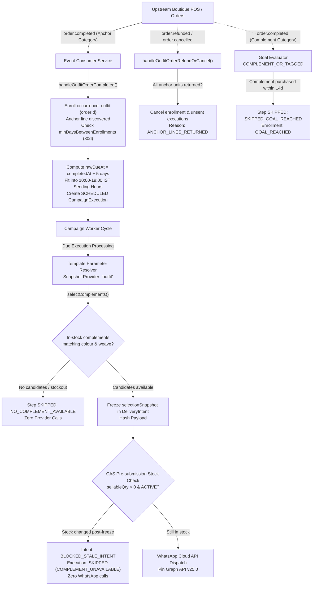

# F24: Preset Complete the Outfit (`complete_the_outfit` / `outfit_completion`)

## 1. Feature Overview & Design Contract
The **Complete the Outfit Preset** (`complete_the_outfit`, aliased to `outfit_completion`) automates post-purchase complement styling suggestions for handloom stores, boutiques, and apparel shops (Spec p5, p13, p14, p17, p18, p19–20, p28, p29, p33).

When a customer purchases an anchor item (such as a silk saree, bridal lehenga, or festive kurta), GroVastra waits a configured delay (+5 days default, fitted into 10:00–19:00 IST boutique sending hours), deterministically matches 1–3 compatible, currently in-stock complements (blouse, dupatta, accessories, petticoat), and sends a single approved WhatsApp template.

### 4 Mandatory Informational Principles (Spec p19, p28)
1. **Orders and products come from other systems**:
   GroVastra connects to external boutique billing and inventory sources (`src_orders`, `src_products`). Production engine code under `apps/api/src/` (excluding isolated dev tooling under `src/dev/`) **NEVER** writes or mutates product or order collections (enforced by AST boundary tests Q26 and OF29).
2. **Suggestions come from product records only; customer names or personal traits are NEVER used**:
   Pairing logic operates exclusively on deterministic product metadata (category, colour family, weave, price). The matching engine has no access to customer gender, religion, size, body measurements, age, or personal demographics (enforced by AST scan in test OF28).
3. **A suggestion never reserves an item; only items in stock when the message is sent are chosen**:
   Matching occurs at execution dispatch time (late binding). A suggestion does not hold inventory or deduct sellable stock.
4. **If not enough matching items are in stock, the step is skipped**:
   Complement bindings (`complement.1.name`, `complement.2.name`, `complement.3.name`) have `allowFallback: false`. If compatible matching items are out of stock or unavailable, the step is safely skipped with reason `NO_COMPLEMENT_AVAILABLE` or `COMPLEMENT_UNAVAILABLE` with zero WhatsApp dispatches.

---

## 2. Technical Architecture & Component Flow



### Component Breakdown
1. **`apps/api/src/presets/completeOutfit/matching.ts`**:
   Pure deterministic complement selector `selectComplements`. Evaluates candidate priority lists, colour family rules, weave affinity, budget constraints, lookback suppression, and tie-breaking.
2. **`apps/api/src/presets/completeOutfit/enroller.ts`**:
   `enrollCompleteOutfitOccurrence`: Discovers qualifying anchor line, validates category, enforces `minDaysBetweenEnrollments` (default 30 days), fits delay to 10:00–19:00 IST sending hours, enforces `FUTURE_ONLY` policy, and records `rawDueAt` and `adjustedDueAt`.
3. **`apps/api/src/presets/completeOutfit/orderHandlers.ts`**:
   - `handleOutfitOrderCompleted`: Enrolls new anchor occurrences and checks complement purchases for goal satisfaction.
   - `handleOutfitOrderRefundOrCancel`: Scoped strictly to `outfit:*` occurrences; stops enrollment if all units of the anchor item are returned.
4. **`apps/api/src/presets/completeOutfit/reconciler.ts`**:
   `reconcileCompleteOutfitCampaign`: Planner reconciliation loop with durable checkpointing (`outfit-reconcile:{campaignId}`).
5. **`apps/api/src/templates/snapshot.ts`**:
   Single late-binding snapshot provider for `'outfit'`. Resolves `anchorItemName`, `complement1Name`, `complement2Name`, `complement3Name`, and returns `outfitSelection` snapshot.
6. **`apps/api/src/presets/completeOutfit/routes.ts`**:
   Exposes `GET /products`, `POST /campaigns/:id/complete-outfit/preview`, and `GET /campaigns/:id/complete-outfit/summary`.

---

## 3. Deterministic Matching Algorithm

The matching algorithm in `apps/api/src/presets/completeOutfit/matching.ts` adheres to strict mathematical determinism:

### Priority Sequence
For an anchor category (e.g. `saree`), candidate categories are evaluated in explicit priority order:
1. `blouse` (Priority 1)
2. `petticoat` (Priority 2)
3. `dupatta` (Priority 3)
4. `accessories` (Priority 4)

For `lehenga` or `kurta`, complement order defaults to:
1. `dupatta`
2. `accessories`

### Candidate Scoring & Colour Match Modes
For each candidate complement product with active status and `sellableQty > 0`:
- **`colourMatch = 'NEUTRAL_OR_SAME'`** (Default):
  - Complement in same colour family as anchor: **+2 points**
  - Complement in a neutral colour family (`black`, `white`, `grey`, `beige`, `gold`, `silver`, `metallic`): **+1 point**
  - Complement in unrelated non-neutral colour family: **Excluded**
- **`colourMatch = 'SAME_FAMILY'`**:
  - Complement in same colour family as anchor: **+2 points**
  - Any other colour family (even neutral): **Excluded**
- **`colourMatch = 'ANY'`**:
  - All colours accepted: **0 points** bonus

### Weave Affinity Bonus
- If `requireSameWeave = true` and complement weave equals anchor weave: **+1 point**.

### Budget Limit Enforcement
- If `budgetMaxPaise` is specified: Candidates with `pricePaise > budgetMaxPaise` are excluded with `EXCLUDED_BUDGET`.
- If `budgetRatio` is specified (e.g. `0.5`): Candidates exceeding `anchorPricePaise * budgetRatio` are excluded.

### Already-Owned & In-Order Suppression
- Candidates in categories purchased by the customer within `alreadyOwnedLookbackDays` (default 180 days) are suppressed (`EXCLUDED_ALREADY_OWNED`).
- If `suppressIfCategoryInOrder = true` (default), categories present in the anchor order receipt are suppressed.

### Tie-Breaking
When candidates share identical priority tiers:
1. Highest total match score (`colourScore + weaveScore`)
2. Lowest price (`pricePaise` ascending)
3. Lexicographical `productId` ascending (stable fallback)

---

## 4. Collections, Fields & Indexes

### Collection: `src_products` (External Inventory Source, Read-Only)
- **Extended Fields**:
  - `category`: String (`saree`, `blouse`, `lehenga`, `kurta`, `dupatta`, `accessories`, `petticoat`, `jewellery`)
  - `colourFamily`: String (`red`, `green`, `blue`, `yellow`, `orange`, `purple`, `pink`, `brown`, `white`, `black`, `grey`, `beige`, `gold`, `silver`, `metallic`)
  - `weave`: String (`silk`, `cotton`, `zari`, `georgette`, `chiffon`, `banarasi`, `linen`, `wool`, `velvet`, `crepe`, `blend`)
  - `pricePaise`: Number (integral paise, e.g. 250000 = ₹2,500.00)
- **Indexes**:
  - `{ tenantId: 1, category: 1, status: 1 }` (Compound index for fast category listing)

### Collection: `src_orders` (External Billing Source, Read-Only)
- **Extended Fields**:
  - `outfitRef`: String (Optional upstream outfit link)
  - `lines`: Array of line items:
    - `productId`: String
    - `variantId`: String
    - `qty`: Number
    - `returnedQty`: Number
    - `lineNetPaise`: Number

### Collection: `campaignEnrollments` (Extended for F24)
- **Fields**:
  - `occurrenceId`: String formatted as `outfit:{orderId}`
  - `anchorLineId`: String (line ID of the qualifying anchor item)
  - `anchorProductId`: String (product ID of the anchor item)
  - `anchorItemName`: String (snapshot name of the anchor item)

### Collection: `campaignDeliveryIntents` (Extended for F24)
- **Fields**:
  - `selectionSnapshot`: Object containing frozen product IDs, variant IDs, names, prices, scores, and match reasons.

### Collection: `campaignVersions` (Extended for F24)
- **Fields**:
  - `pairing`: `CompleteOutfitPairingConfig`
  - `goalMode`: `'COMPLEMENT_OR_TAGGED' | 'TAGGED_ONLY'`

---

## 5. State Transitions & Reason Codes

### Reason Precedence & Pre-Submission CAS
1. `NO_ANCHOR_LINE`: Order contained no lines matching configured anchor categories.
2. `RECENTLY_SUGGESTED`: Customer was enrolled in an outfit campaign within `minDaysBetweenEnrollments` (30 days).
3. `ANCHOR_ORDER_NO_LONGER_QUALIFIES`: Anchor order was fully refunded or cancelled before enrollment.
4. `ANCHOR_LINES_RETURNED`: Anchor line items were returned; active enrollment and unsent executions cancelled.
5. `NO_COMPLEMENT_AVAILABLE`: No compatible in-stock complements found during template snapshot generation.
6. `COMPLEMENT_UNAVAILABLE`: Pre-submission check detected that a selected complement sold out after intent creation.
7. `BLOCKED_STALE_INTENT`: Delivery intent blocked due to inventory stockout; CAS state transition prevents duplicate provider calls.
8. `SKIPPED_GOAL_REACHED`: Customer purchased a complement item or placed a tagged order; campaign objective met.
9. `REPLY_HOLD`: Customer replied on WhatsApp; marketing steps held.
10. `MARKETING_OPT_OUT`: Customer opted out of promotional messages.

---

## 6. API Reference with PowerShell Examples

### 1. List Products (Tenant Scoped, Read-Only)
**`GET /products?category=blouse&colourFamily=red&status=ACTIVE`**

```powershell
$headers = @{
  "Authorization" = "Bearer $token"
}
$response = Invoke-RestMethod -Uri "http://localhost:4000/products?category=blouse&colourFamily=red" -Headers $headers -Method GET
$response | ConvertTo-Json -Depth 4
```

### 2. Test with an Order (Outfit Match Simulation)
**`POST /campaigns/:id/complete-outfit/preview`**

```powershell
$headers = @{
  "Authorization" = "Bearer $token"
  "Content-Type"  = "application/json"
}
$body = @{
  orderId = "order_saree_01"
} | ConvertTo-Json

$response = Invoke-RestMethod -Uri "http://localhost:4000/campaigns/cmp_outfit_01/complete-outfit/preview" -Headers $headers -Method POST -Body $body
$response | ConvertTo-Json -Depth 4
```

### 3. Complete Outfit Summary (Observational Reporting)
**`GET /campaigns/:id/complete-outfit/summary`**

```powershell
$headers = @{
  "Authorization" = "Bearer $token"
}
$response = Invoke-RestMethod -Uri "http://localhost:4000/campaigns/cmp_outfit_01/complete-outfit/summary" -Headers $headers -Method GET
$response | ConvertTo-Json -Depth 4
```

### 4. Dev-Only: Simulate Order Line Return
**`POST /dev/mock-orders/:orderId/lines/:lineId/return`**

```powershell
$headers = @{
  "Authorization" = "Bearer $token"
  "Content-Type"  = "application/json"
}
$body = @{
  qty = 1
} | ConvertTo-Json

$response = Invoke-RestMethod -Uri "http://localhost:4000/dev/mock-orders/order_saree_01/lines/line_saree_01/return" -Headers $headers -Method POST -Body $body
$response | ConvertTo-Json -Depth 4
```

---

## 7. Edge Cases & Reviewer Q&A

**Q: What happens if an anchor saree order has 2 saree lines?**
**A:** The first qualifying anchor line by line sequence is selected as the anchor item. The occurrence ID is keyed by `outfit:{orderId}` ensuring strictly one outfit enrollment per qualifying bill.

**Q: If the customer returns 1 unit of a 2-unit saree line, does the campaign halt?**
**A:** No. As long as `returnedQty < qty` (remaining net quantity > 0), the anchor line remains valid and the campaign proceeds. Only when all units of the anchor line are returned (`returnedQty >= qty`) is the enrollment halted with `ANCHOR_LINES_RETURNED`.

**Q: Does purchasing an unrelated product (e.g. kidswear) stop the campaign?**
**A:** No. Under `COMPLEMENT_OR_TAGGED` goal mode, only orders containing products in the complement categories (`blouse`, `petticoat`, `dupatta`, `accessories`) or explicitly tagged orders stop the campaign. Unrelated purchases update customer facts but do NOT cancel outfit recommendations.

**Q: What if the selected blouse sells out 2 minutes after intent creation?**
**A:** The worker's pre-submission CAS check evaluates variant `sellableQty` directly before handing off to the WhatsApp adapter. If stock is 0, the intent is marked `BLOCKED` with reason `BLOCKED_STALE_INTENT` and the execution is skipped with `COMPLEMENT_UNAVAILABLE`. Zero messages are sent to WhatsApp.

**Q: Are customer names or traits ever used in pairing?**
**A:** Never. Personal traits (gender, religion, size, body measurements, age) are completely omitted from the matching engine. Pairing is strictly product-to-product compatibility.
